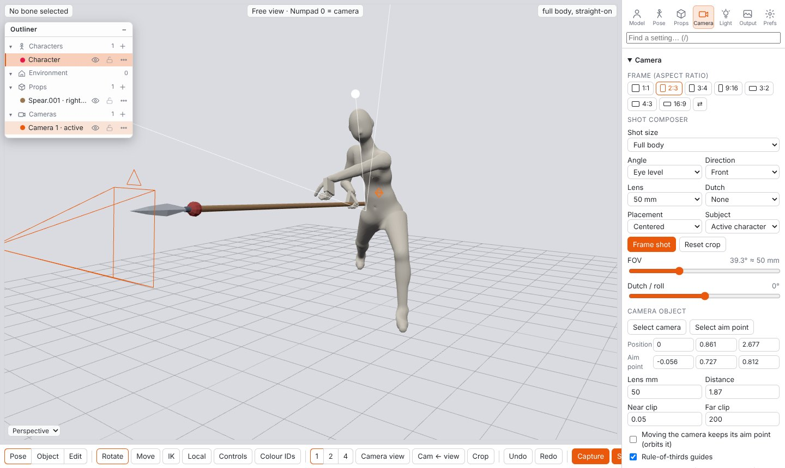
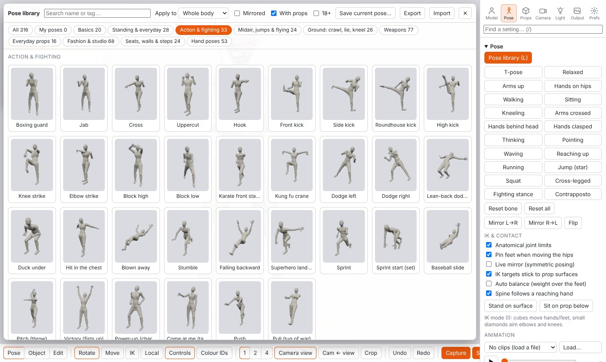

# Marionette — 3D posing for ControlNet

Inspired by 3D Openpose Editor. Marionette is a 3D pose editor for **Forge**, **reForge** and **Forge Neo**. Pose rigged characters, frame them with a camera, and send OpenPose / Depth / Normal / Canny / Seg maps straight into ControlNet.

## Features
- **Real rigged models:** GLB, VRM, Mixamo FBX, VRoid, Rigify and UE. Includes a parametric mannequin and two realistic base bodies.
- **Posing:** Maya-style rotate rings, IK with contact pins, anatomical joint limits, mirroring and finger controls.
- **Pose library:** about 360 full-body poses with thumbnails and 53 hand shapes. Categories cover action, midair, ground, weapons, fashion and seated/leaning. An adult category is hidden until you enable it.
- **Props:** about 50 weapons and handheld items that snap into the hand with fingers wrapped around the grip. Seats, walls and stairs that poses rest on without clipping. A small Blender-style modeler is also included.
- **Pose from image:** detection with DWPose/OpenPose, rebuilt in 3D from the camera's point of view.
- **Scenes:** multiple characters and cameras, all in an Outliner. Shot composer, aspect presets (1:1 · 2:3 · 3:4 · 9:16 · 3:2 · 4:3 · 16:9) and lighting.
- **Extras for any model:** horns and animal ears.
- **One-click send:** fills the ControlNet units and sets the control type, preprocessor (None) and a matching model.

## Install
1. In WebUI, open **Extensions → Install from URL**, paste this repo's URL and install. You can also copy the folder into `extensions/` by hand.
2. Restart WebUI fully. *Reload UI* is not enough.

There is no build step and no network access is needed: three.js and its add-ons are vendored in `web/vendor`.

You can add your own models to `extensions/sd-webui-marionette/models/` or `models/RiggedPose/`, or open them with *Open file*.

## Usage
1. Open the **Marionette** tab, or the *Marionette 3D Pose* accordion in txt2img or img2img.
2. Pick a pose from the library (`L`), or detect one from a photo.
3. Adjust bones with the rings, or with IK (`I`).
4. Frame the shot on the **Camera** tab.
5. Click **Capture**, then **Send**.

Press `/` to search for any setting by name.

## Notes
- The realistic base bodies come from Blender Studio's *Human Base Meshes* (CC0) and were auto-rigged for this extension. The stylised bodies in that pack are not included.
- Adult content is opt-in, hidden by default, and only for adult characters.
